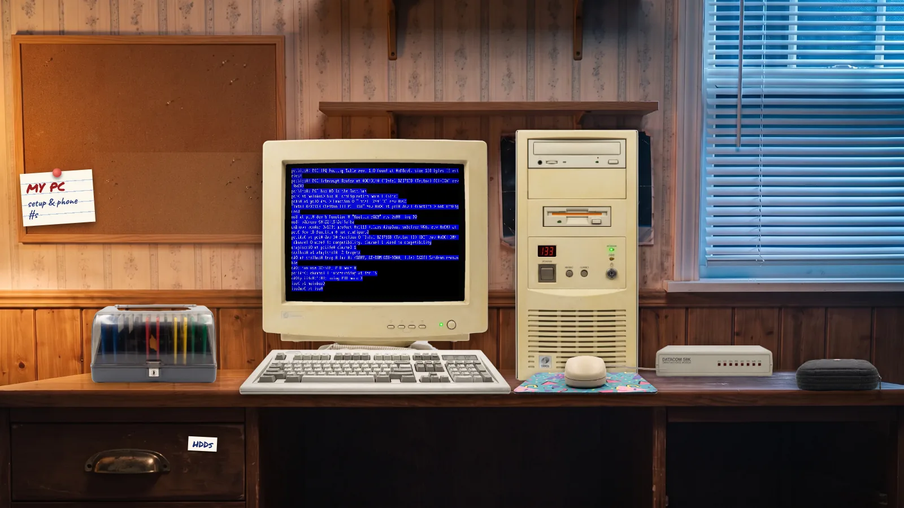

# beigebox

A 1996 PC on a teenager's desk, in your browser. Press the big **POWER** button.
**[beigebox.emdzej.pl](https://beigebox.emdzej.pl)**



- **Floppies** stand in the disk box: open it, pick one, it goes into drive A:.
- **CDs** are in the wallet: press the drive's eject button, then click the tray.
- **Hard disks** are in the drawer under the desk. Unwrap a blank one, FDISK and
  FORMAT it from a DOS floppy, and it remembers what you install. Drives only go
  in with the power off.
- **Setup notes** pinned to the cork board: tower or desktop case, CRT or LCD,
  RAM, network card, and the modem's phone book.
- **Drop** any `.img`, `.iso` or `.zip` onto the page and it is filed in the right place.

Click the monitor to lean in; click again to capture the mouse.
<kbd>Ctrl</kbd>+<kbd>Alt</kbd>+<kbd>End</kbd> sends Ctrl+Alt+Del.

## How it fits together

- [**v86**](https://github.com/copy/v86) emulates the PC. It is loaded from npm
  on the first press of POWER; the BIOS images in `public/v86/` come from its
  repository.
- [**csfs**](https://github.com/emdzej/csfs) is every disk's file system. One
  adapter, `src/lib/emulator/disk-buffer.ts`, serves a csfs file to v86 as a
  disk, so the same code reads from:
  - the **shelf** — `public/media/`, over static HTTP with `Range` requests (a
    700 MB CD costs only what the guest reads), including images inside zips;
  - the **drawer** — your disks, in the browser's private storage (OPFS);
  - a **linked folder** on your computer (File System Access, Chromium).

  Guest writes go to an in-memory overlay. On power-off (and floppy eject) they
  are written back to your own disks; changes to shelf disks are discarded.
- **Network**: an NE2000 on the `fetch` backend (HTTP, no server) or a WebSocket
  ethernet relay. **Modem**: Hayes 56K on COM2, dialling WebSocket URLs from the
  phone book (`ATDT 5551234`).

## Develop

```sh
pnpm install
pnpm dev        # copies v86.wasm, builds the media manifest, starts vite
pnpm typecheck
BASE_PATH=/beigebox/ pnpm build
```

Pushing to `main` deploys to GitHub Pages (`.github/workflows/pages.yml`).

## Licence

Code MIT. Bundled OS images keep their own licences — see `public/media/README.md`.
